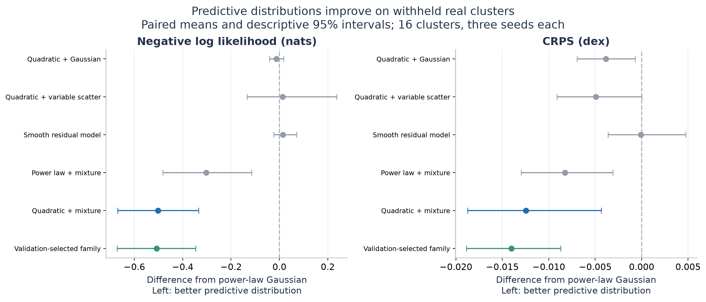
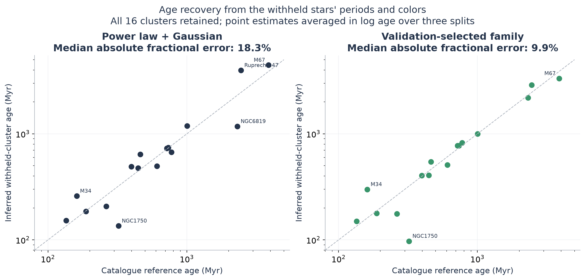
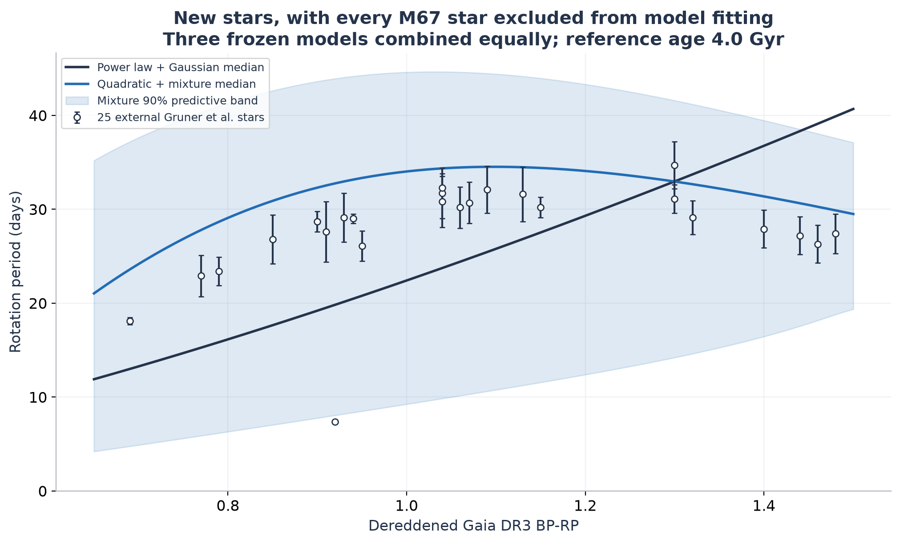

# Predicting stellar rotation and cluster ages

This project now has a working probabilistic model tested on **721 real stars
in 16 withheld clusters**, plus **25 additional M67 stars** absent from the
original catalogue. It predicts a distribution of rotation periods at a supplied
age and color and can estimate the age of a coeval stellar population.

The main advance is modeling the narrow slow-rotation sequence and the broader
fast-rotation tail separately. The slow component remains an explicit quadratic
in log age and color. Every reported cluster test excludes that entire cluster
from both fitting and model selection.

[Real-star results](docs/REAL_STAR_RESULTS.md) ·
[Research handout (PDF)](output/pdf/real_star_research_brief.pdf) ·
[Science fair guide](docs/SCIENCE_FAIR_GUIDE.md) ·
[Protocol](docs/REAL_STAR_PROTOCOL.md) ·
[Research log](docs/RESEARCH_LOG.md)

## Progress on real observations

| Test | Power-law Gaussian | Quadratic mixture |
|---|---:|---:|
| Held-out distribution score, NLL (lower is better) | 0.0061 | **-0.4960** |
| Held-out CRPS, dex (lower is better) | 0.1205 | **0.1080** |
| Observed coverage of 68% prediction intervals | 80.7% | **68.4%** |
| Observed coverage of 90% prediction intervals | 92.1% | **90.0%** |
| Held-out median-prediction MAE, dex | 0.1516 | **0.1339** |
| Held-out mean-prediction RMSE, dex | **0.2195** | 0.2251 |
| External M67 mean-prediction RMSE, dex | 0.1537 | **0.1174** |

The mixture improves NLL in **15 of 16** cluster averages. The predeclared paired
NLL difference is **-0.5021 nats**, with descriptive 95% interval
**[-0.6694, -0.3346]**. CRPS improves by about **10.3%**, supporting a better
predictive distribution under a second proper scoring rule. Mean-prediction RMSE
does not improve on the primary sample; the result is stronger distribution and
median prediction, not a win on every metric.



Six model families were evaluated in 48 identical discovery/validation/test
splits. Parameters, regularization and a separate model-family selector use only
discovery and validation clusters. All seven reported methods, every cluster,
and all predictions are available in the full results. Bootstrap intervals do
not include all dependence from overlapping training sets or systematic age errors.

## Cluster ages and an external check

Median absolute fractional error in withheld-cluster age estimates is **18.3%**
for the power law, **12.5%** for the quadratic mixture, and **9.9%** when the model
family is chosen by validation data. Some clusters still have large errors, and
the paired interval on the change in mean log-age error spans zero. These are
cluster point estimates, not 10%-accurate individual-star ages.



On 25 separate Gruner et al. (2023) M67 stars, the quadratic mixture reduces
mean-prediction RMSE by approximately **23.6%** versus the power law. All M67
stars were excluded from the models used here, and the external observations
were not used to choose a model. The ordinary quadratic Gaussian is competitive
at 0.1249 dex RMSE. This is a separate-star check in one old cluster; it does not
yet establish performance on field stars or every stellar population.



The shaded band describes population spread. It is wider than needed for much
of this externally selected single-star sample: 68% intervals cover 92% of these
observations. Every selected observation is shown, including the fast outlier.
See [external data provenance](project/data/external/README.md) and the full
results for the age-scale sensitivity and all competing models.

## Try the fitted model

Set up the recorded Python/Julia environment, then predict rotation at a supplied
age and dereddened Gaia DR3 color:

```bash
bash scripts/setup_environment.sh
.venv/bin/python scripts/predict_rotation.py --age-myr 1000 --bp-rp 1.0
```

The example gives a median period of about **11.1 days** and a 68% population
interval of **7.5-12.9 days**. The command enforces the observed application domain:
135-3870 Myr and 0.65 < BP-RP < 1.5. The application model is fitted to all primary
stars after evaluation; held-out scores use separate frozen models.

Estimate a coeval population's age from a CSV containing `Prot` (days), `BPRP_0`
and optionally `GaiaDR3_ID`. For the saved external check:

```bash
.venv/bin/python scripts/infer_cluster_age.py project/results/real_stars_v2/external_stars.csv --holdout-cluster M67
```

This uses the three M67-excluded models and returns about **3.38 Gyr**, compared
with the source's approximate 4.0 Gyr reference. The source also discusses a
3.6 Gyr isochrone fit. Per-fit variation is not a calibrated age confidence
interval. For a genuinely new population, omit `--holdout-cluster` to use the
application model. Known training-ID overlap is rejected when IDs are supplied.

## Reproduce the real-star study

```bash
OPENBLAS_NUM_THREADS=1 .venv/bin/python scripts/run_real_star_study.py
.venv/bin/python scripts/evaluate_external_m67.py
.venv/bin/python scripts/fit_rotation_model.py
.venv/bin/python scripts/report_real_stars.py
.venv/bin/python scripts/make_real_star_brief.py
OPENBLAS_NUM_THREADS=1 .venv/bin/python scripts/verify_real_star_reproducibility.py
.venv/bin/python -m pytest -q
```

The runner resumes completed fits and refuses to mix incompatible source, split
or configuration hashes. To make a fresh run without altering the reference
bundle, change `study_id` in `configs/real_stars.json` in a separate checkout
and run the fitting command there. Its output goes to the new study directory;
the reporting tools continue to read the reference `real_stars_v2` bundle.
The replay command above refits every candidate and compares parameters and
selection scores without changing the reference fits. Numerical work uses NumPy/SciPy; it does not
require rerunning PySR. Exact Python and Julia versions are recorded in
[environment notes](environment/README.md).

The tests verify likelihood gradients, normalized densities, scoring rules,
complete predictions, split separation, matching baseline scores, external-ID
non-overlap, frozen model hashes and age-grid maxima. All current figures have
PNG and SVG versions; use SVG for a large science-fair display.

## Why the project changed its model

The original question was whether symbolic regression could recover a useful
stellar-rotation equation. The completed initial study ran **258 equation searches**:
180 controlled main trials, 48 cluster holdouts and 30 fresh follow-up trials.
Independent validation recovered the known synthetic functions in 157/180 main
trials versus 76/180 for default selection. A quadratic baseline recovered 164/180.
On real stars, symbolic regression did not establish an advantage over a power law.

That finding motivated the distributional follow-up: one average curve does not
capture the observed spread of periods. The new model makes measurable progress
on real observations while preserving the initial experiment and its conclusions.

- [Initial protocol and complete results](docs/RESULTS.md)
- [Initial four-page report](output/pdf/stellar_rotation_research_brief.pdf)
- [Initial search configuration](configs/study.json)
- [Fresh-seed confirmation configuration](configs/domain_confirmation.json)

To regenerate initial tables and figures, run `scripts/run_study.py --stage
summarize`, `scripts/summarize_results.py`, `scripts/domain_followup.py`,
`scripts/make_results_document.py`, `scripts/make_figures.py` and
`scripts/make_brief.py`. `scripts/verify_reproducibility.py` replays the saved
nontrivial search that reproduced all 17 candidate equations and losses.

## Data, attribution and research record

The [ChronoFlow catalogue](project/data/README.md) contains 8,412 entries. Recorded
quality, age/color, membership and cluster-size cuts produce the 721-star primary
sample. No upper-period or model-residual cut is applied. Ages remain estimates;
the sample retains rotation scatter and possible contaminants.

[ChronoFlow](https://arxiv.org/abs/2412.12244) and
[gyro-interp](https://arxiv.org/abs/2303.08830) motivate modeling rotational
variation. [PySR](https://arxiv.org/abs/2305.01582) powers the initial equation
searches. [Gruner et al. (2023)](https://arxiv.org/abs/2305.16997) provide the external
observations. This repository does not reproduce those methods in full or claim
a new physical braking law. Its contribution is the documented comparison,
diagnosis, observational checks and usable prediction tools.

`src/astrogyro/` contains active code. `project/results/research_v1/` and
`domain_confirmation/` retain the equation study; `project/results/real_stars_v2/`
contains the new frozen fits, predictions, age profiles and application model.
Other notebooks/results/figures are historical exploration, labeled accordingly.

These revisions used AI assistance for research, design, code, execution, figures
and writing. Published measurements remain attributed to their sources. A student
presenter should identify their own contributions and be able to inspect and
explain the analysis. Past commit wording is preserved in Git history; new commits
describe the concrete scientific work.
