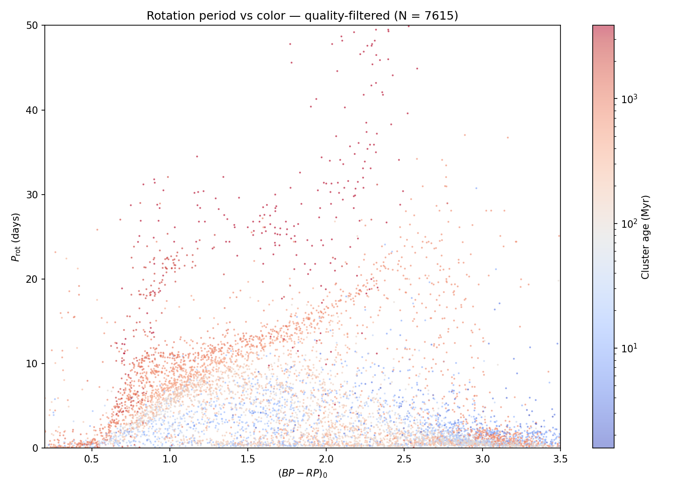
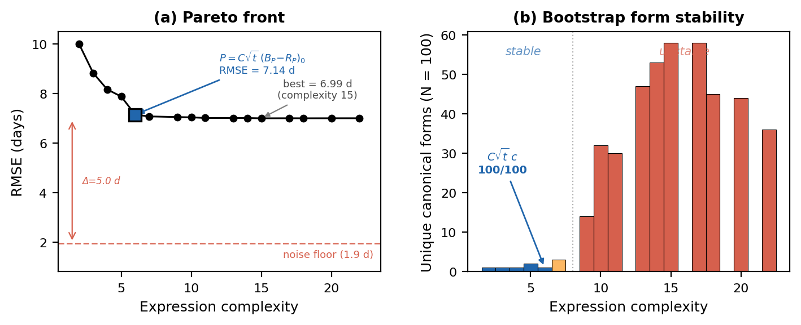
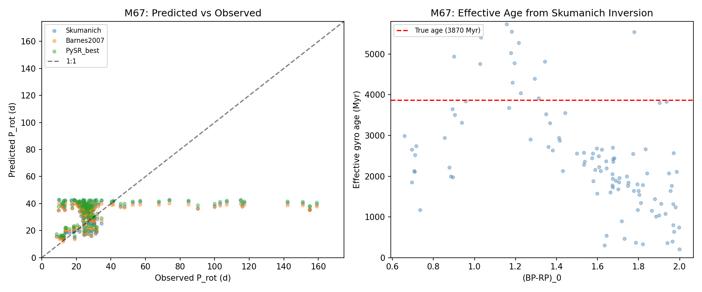

# Gyrochronology

Stars slow down as they get older. A young one spins around in a couple of days; an old one takes weeks. So if you can measure how fast a star turns, you can guess its age. This is me checking whether a machine handed nothing but the data lands on the same equation astronomers have used since 1972, or talks itself into a fancier one that isn't really there.

I got into this after reading the [ChronoFlow paper](https://arxiv.org/abs/2412.12244). It's a neural network that dates stars from their spin, and it works, but it hands you an age and never an equation. I wanted the equation. There has been a clean formula for this since Skumanich wrote it down in 1972: period grows like the square root of age. I wanted to know whether a search starting from nothing would beat it or walk straight back to it.

So instead of a neural net I used [symbolic regression](https://github.com/MilesCranmer/PySR), which evolves actual algebra to fit data, and pointed it at about 5,300 stars across 29 clusters. Clusters are the trick here: every star in one is the same known age, so they pin the relationship down.

The catch with letting a machine invent equations is that it will always find one that fits a hair better. What you actually want to know is whether that equation is real or just memorizing the noise. So I re-ran the entire search on a hundred resampled copies of the data and counted how often each equation's shape came back. A real law turns up every time. Noise turns up once and never again.

It came back to Skumanich. The simple form, period as the square root of age times color, showed up in all hundred runs. The fancier equations that edged it out on paper were different every single time, fitting scatter rather than signal. A one-line `scipy.curve_fit` matched the whole symbolic-regression pipeline in cross-validation. The data just doesn't hold enough to support anything more elaborate than the 1972 answer.

To check the relation does something useful, I inverted it to age a few tens of thousands of Kepler field stars, then pushed it onto M67, an old cluster where the simple law is known to break. Stars past about four billion years stop slowing down on schedule, and the predictions overshoot them exactly there.

## What's here

The write-up is a short research note in `project/paper`. The pipeline in `project/notebooks` cleans the catalog, fits the classical baselines, runs the symbolic regression, repeats it across the hundred resamples, and does the cross-validation and synthetic-control checks. Its output lands in `project/results`, and the plots in `project/figures`. The `chronoflow` and `GPgyro` folders are external packages I borrowed from, not my code.

## Made by

Kai Vaid. The star catalog comes from ChronoFlow; the equation search uses PySR.
