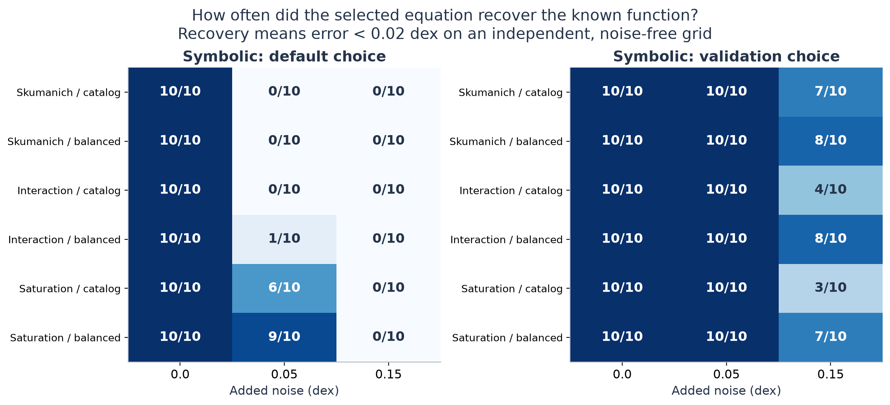
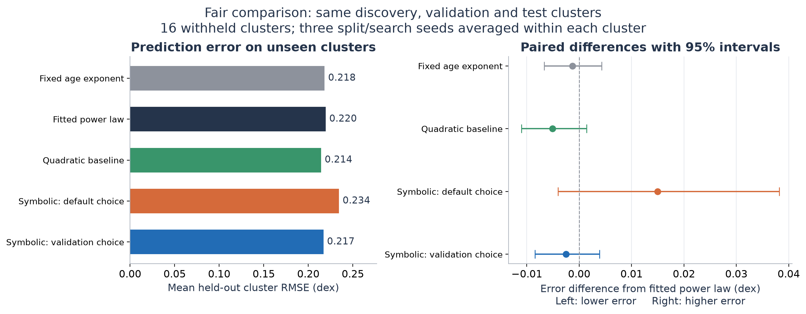

# Can an equation search learn stellar rotation?

This project tests when symbolic regression recovers a known function and whether
it predicts stellar rotation better than simple baselines. It uses published
star-cluster measurements, controlled synthetic data, and whole-cluster holdouts.

**Completed study: 180 controlled searches, 48 cluster-holdout searches, and
721 observed stars in 16 clusters.** All candidate equations, seeds, splits and
test predictions are saved. The protocol was fixed before the main runs, after
an audit and execution pilots; this is an exploratory follow-up.

A further **30 fresh-seed searches** test a fixed follow-up, bringing the total
to 258 searches, excluding pilots and the one-search reproducibility replay.

The strongest result concerns **how an equation is selected**. In 94 of 180
controlled trials, PySR's default selector missed an accurate function that was
already among its candidates. Independent validation substantially improved
recovery in this benchmark. On real stars, symbolic regression has **not
demonstrated better prediction than a fitted power law**.

[Research brief (PDF)](output/pdf/stellar_rotation_research_brief.pdf) ·
[Full results](docs/RESULTS.md) ·
[Science fair presentation guide](docs/SCIENCE_FAIR_GUIDE.md) ·
[Protocol](docs/PROTOCOL.md) ·
[Research log](docs/RESEARCH_LOG.md)

## What the experiment found

The controlled experiment varies the known function, sampling coverage and
measurement noise. Each cell below represents ten trials. Recovery requires
less than 0.02 dex error against the known function across a separate evaluation
grid; it measures predictive agreement, not identical algebra.



Across the 180 configured trials, default selection recovered the function
76 times and validation selection 157 times. The quadratic baseline recovered
164 times. These totals describe this particular mix of mathematical examples,
including an exactly quadratic interaction law; they are not universal success
rates for equation discovery. The full results include continuous errors and
all five methods.

Two validation-selected equations were undefined at some evaluation inputs and
count as failures. A separately labeled, post-hoc domain check replaced both
choices and raised recovery to 159/180 on the same trials. In 30 fresh trials
at 0.15 dex noise with catalogue sampling, neither selector produced an invalid
function, so the guard changed no choices. Validation recovered 21/30 functions
versus 0/30 for default selection. This supports the selection finding in that
condition, but does not confirm a further accuracy benefit from the guard.

For real observations, every cluster is tested while excluded from both fitting
and validation. Three split/search seeds are averaged within each cluster,
then the 16 clusters receive equal weight. Lower error is better.

| Method | Mean held-out cluster RMSE, dex |
|---|---:|
| Fixed age exponent | 0.2182 |
| Fitted power law | 0.2195 |
| Quadratic baseline | 0.2144 |
| Symbolic regression, default selection | 0.2345 |
| Symbolic regression, validation selection | 0.2170 |



Validation-selected symbolic regression minus the fitted power law is
**-0.0025 dex**, with a descriptive paired 95% interval of **[-0.0085, +0.0039]**.
This interval spans zero. The study establishes neither superiority nor
equivalence. The quadratic baseline also lacks a clear advantage over the power
law at this precision. The intervals do not capture all dependence from shared
training sets or systematic errors in cluster ages.

## What it is trying to replicate

The physical starting point is the Skumanich-inspired idea that rotation period
grows approximately as the square root of stellar age. The one-parameter
baseline here adds a chosen linear color dependence; that full expression is
an approximation, not the original 1972 result.

The data come from [ChronoFlow](https://arxiv.org/abs/2412.12244), which models a
distribution of rotation periods conditioned on age and color. This project
uses [PySR](https://arxiv.org/abs/2305.01582) to search for explicit equations.
It does not reproduce ChronoFlow's probabilistic model or benchmark against its
age estimates. Logarithmic age and color inputs encode scientific assumptions.

The controlled experiment tests whether the search can recover known functions.
The observational experiment tests period prediction at supplied cluster ages.
Neither establishes a new stellar-aging law, a magnetic-braking transition, or
calibrated individual-star ages. Repeatedly choosing an equation alone would
not establish those claims.

## Data and figures

The [original catalogue and provenance](project/data/README.md) contain 8,412
entries. Quality flags, age/color bounds, membership scores and minimum cluster
size produce the 721-star primary sample. There is no upper period cut or
model-residual cut. Membership filtering does not eliminate all contaminants,
binaries or fast rotators. Cluster ages remain estimates.

- [Sample and cluster counts](project/figures/research_v1/sample.png)
- [Continuous controlled-experiment errors](project/figures/research_v1/synthetic_recovery.png)
- [Every held-out cluster](project/figures/research_v1/cluster_errors.png)
- [M67 held out from fitting and validation](project/figures/research_v1/m67_holdout.png)
- [Training-sample sensitivity on common test stars](project/figures/research_v1/sample_sensitivity.png)

Every figure has an SVG version in the same directory for printing. All selected
observations are included in the sample plot. The M67 plot shows all 25 selected
M67 stars; its shaded bands are the range across three fits, not confidence
intervals. Sample selection changed from the historical analysis, so old and new
error numbers are not directly comparable.

## Reproduce the study

The recorded environment uses Python 3.11.8, PySR 2.7.0, SymbolicRegression.jl
2.7.1 and Julia 1.13.2 on macOS arm64. See [environment notes](environment/README.md).
The first setup downloads Julia dependencies. The catalogue is checked in;
historical submodules are optional.

```bash
bash scripts/setup_environment.sh
.venv/bin/python -m pytest -q
```

To rebuild tables, follow-up results, figures and the PDF from saved searches:

```bash
.venv/bin/python scripts/run_study.py --stage summarize
.venv/bin/python scripts/summarize_results.py
.venv/bin/python scripts/domain_followup.py
.venv/bin/python scripts/summarize_results.py --results project/results/domain_confirmation
.venv/bin/python scripts/domain_followup.py --results project/results/domain_confirmation --fresh-trials
.venv/bin/python scripts/make_results_document.py
.venv/bin/python scripts/make_figures.py
.venv/bin/python scripts/make_brief.py
```

To rerun all searches into a separate directory, retaining the reference bundle:

```bash
OPENBLAS_NUM_THREADS=1 JULIA_NUM_THREADS=1 .venv/bin/python scripts/run_study.py --output tmp/independent_run
.venv/bin/python scripts/summarize_results.py --results tmp/independent_run
```

The 30-search follow-up can likewise be rerun with
`--config configs/domain_confirmation.json --stage synthetic --output tmp/fresh_confirmation`.
Run `scripts/summarize_results.py --results tmp/fresh_confirmation`, followed by
`scripts/domain_followup.py --results tmp/fresh_confirmation --fresh-trials` to score it.

On the recorded machine the 228 searches used about 30 minutes of summed search
time across independent processes. Runtime varies. Interrupted runs resume from
completed trials; configuration, data and computational-source hashes prevent
mixing incompatible runs. An exact-seed replay of one nontrivial trial reproduced
all 17 candidate equations and their losses:

```bash
OPENBLAS_NUM_THREADS=1 JULIA_NUM_THREADS=1 .venv/bin/python scripts/verify_reproducibility.py
```

The tests check invalid-prediction penalties, source checksums, split separation,
complete experiment counts, candidate selection, per-star prediction coverage,
saved scores and cluster-level aggregation. They do not establish that the
scientific model is correct.

## Repository map and provenance

| Path | Role |
|---|---|
| `src/astrogyro/` | Active data, model, scoring and experiment code |
| `configs/study.json` | Fixed main-run configuration |
| `project/results/research_v1/` | Auditable current results and run manifest |
| `project/figures/research_v1/` | Current PNG and SVG figures |
| `docs/` | Protocol, findings, research log and presentation guide |
| `project/notebooks/`, older results/figures | Historical exploration; unsupported as current evidence |

The previous README overstated what bootstrap equation recurrence and the M67
plot established. Those claims are superseded by this study; historical files
remain available for audit. A past commit's wording is part of Git history and
is not generated by the experiment or by pushing.

Published measurements belong to their original sources. This revision used AI
assistance for research, code, experiments, figures and writing; the research log
records the work. A presenter should distinguish their own contributions and be
able to explain and inspect the analysis.
