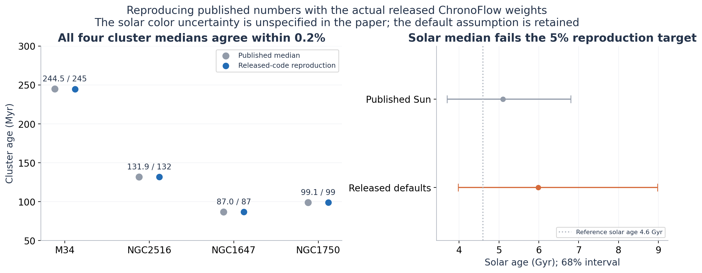
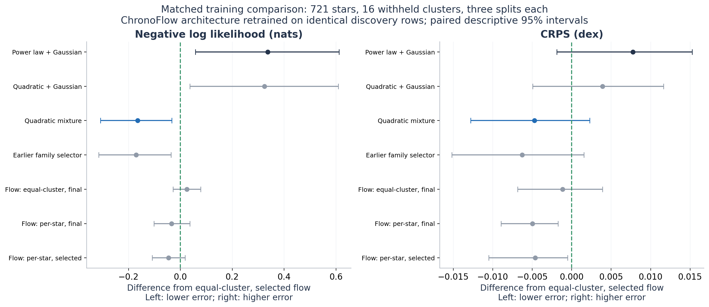
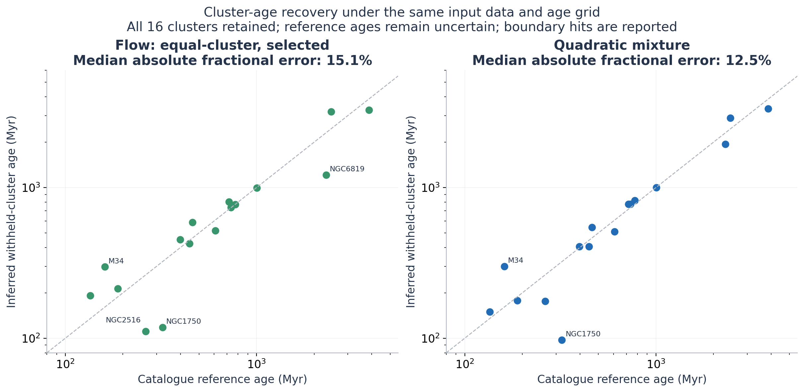
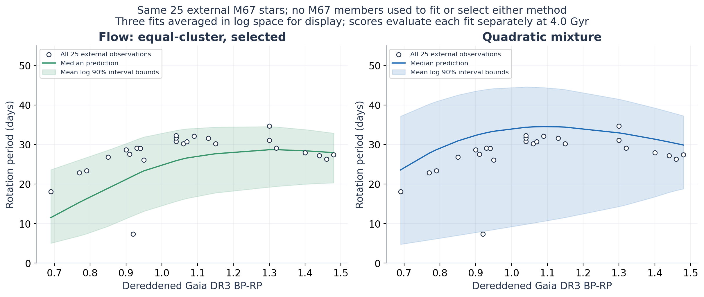

# Published-model reproduction and matched comparison

This study runs the actual released ChronoFlow network, reproduces four published
cluster-age examples, and retrains its architecture for a controlled comparison
with this repository's models. It does not reproduce the paper's entire
cross-validation study or establish a new physical braking law.

The four reproduced cluster medians agree within 0.2%. The solar example does
not meet the predeclared 5% agreement target under the released defaults.
In the matched comparison, the primary NLL difference (quadratic mixture minus
validation-selected, equal-cluster flow) is **-0.1650
nats**, with descriptive 95% interval **[-0.3077,
-0.0327]**. The mixture has lower mean NLL in this benchmark.

[Protocol](PUBLISHED_BENCHMARK_PROTOCOL.md) ·
[Configuration](../configs/published_benchmark.json) ·
[Complete result bundle](../project/results/published_benchmark_v1/)

## What was reproduced

The [authors' released code and weights](https://github.com/philvanlane/chronoflow/tree/f0b766f7d057c4e8f9a64a867414d25c5d985cd6)
are pinned at the existing submodule commit. The unmodified tutorial likelihood
reproduces -3.46 to its printed precision; the vectorized adapter agrees with
native scalar calls. Its CDF and likelihood pass normalization checks.

For the numerical examples in [Van-Lane et al. (2025)](https://arxiv.org/html/2412.12244v2),
we apply the documented quality cuts, the age-inference color threshold, measured
color errors and membership probabilities. The four cluster populations were
excluded from the released model's training according to the paper. They are
not ordinary training-set age fits. The table gives raw posterior intervals;
separate saved summaries also include the reported 0.06-dex intrinsic scatter.

| object | n_stars | reference_median_myr | q16_myr | median_myr | q84_myr | fractional_difference | within_5_percent |
| --- | --- | --- | --- | --- | --- | --- | --- |
| Sun | 1 | 5100.0 | 3976.434 | 5987.951 | 8981.169 | 0.174 | False |
| M34 | 68 | 245.0 | 231.902 | 244.53 | 258.896 | -0.002 | True |
| NGC2516 | 535 | 132.0 | 126.796 | 131.925 | 137.132 | -0.001 | True |
| NGC1647 | 19 | 87.0 | 72.629 | 86.989 | 107.717 | -0.0 | True |
| NGC1750 | 14 | 99.0 | 82.595 | 99.081 | 126.553 | 0.001 | True |



The solar period and color match the paper, but its color uncertainty is not
specified. Using the released default gives 5.99 Gyr rather than 5.1 Gyr. The
post-hoc sensitivity table retains all tested color-error/outlier settings and
shows substantial input sensitivity. No alternative input replaces the failed
primary reproduction or proves what the authors originally used.

Another reproducibility issue is prior measure: the released implementation is
uniform in log age, whereas the paper describes a uniform age prior. The primary
run follows the code; the saved uniform-linear-age sensitivity is separate.
Doubling the age-grid resolution checks numerical convergence. These are
partial numerical reproductions, not a recreation of the paper's full training
process, global precision claim or uncertainty budget.

## Comparison with identical training and test rows

The upstream repository releases one final checkpoint, but no cluster-specific
cross-validation weights or complete training loop. Evaluating that checkpoint
on our ordinary test clusters would leak training information. Instead, the
controlled comparison retrains the published zuko neural-spline-flow architecture
on every frozen discovery split: **721 stars, 16 test clusters, three splits each**.
The entire test cluster is excluded from both fitting and validation.

Each of the **96 neural fits** receives 5,000 full-batch Adam steps. Half use equal
cluster weights, matching our existing study; half use the paper-style per-star
weighting. Both final and validation-selected checkpoints are retained. Selection
uses mean validation-cluster NLL at the 50 prescribed checkpoints. Architecture,
learning-rate schedule and stopping budget never use outer-test scores.

This is retraining of the published architecture under a documented benchmark
protocol. Missing original optimizer/batching/scheduler details prevent a claim
of identical original training. The source's 17,733-parameter architecture,
three spline layers, eight bins and membership/background likelihood are retained.
All methods receive the same discovery, validation and test rows. The flow uses
the available color uncertainties; our earlier mixture ignores that input.
Native likelihoods differ: the flow has its published uniform contaminant
component, while our mixture models the selected population directly.

Lower NLL, CRPS, RMSE and MAE are better. NLL is measured in nats for a density on
log10 period. Other period errors are in dex. RMSE evaluates mean log period;
MAE evaluates the predicted median. Average three splits within each cluster,
then weight the 16 clusters equally.

| Method | NLL | CRPS | RMSE | MAE | 68% coverage | 90% coverage |
| --- | --- | --- | --- | --- | --- | --- |
| Power law + Gaussian | 0.0061 | 0.1205 | 0.2195 | 0.1516 | 80.7% | 92.1% |
| Quadratic + Gaussian | -0.0065 | 0.1166 | 0.2144 | 0.1442 | 81.2% | 91.3% |
| Quadratic mixture | -0.4960 | 0.1080 | 0.2251 | 0.1339 | 68.4% | 90.0% |
| Earlier family selector | -0.5017 | 0.1065 | 0.2231 | 0.1316 | 68.2% | 89.8% |
| Flow: equal-cluster, final | -0.3059 | 0.1116 | 0.2310 | 0.1393 | 59.1% | 93.0% |
| Flow: equal-cluster, selected | -0.3310 | 0.1127 | 0.2324 | 0.1402 | 61.4% | 94.0% |
| Flow: per-star, final | -0.3647 | 0.1078 | 0.2240 | 0.1344 | 59.5% | 92.6% |
| Flow: per-star, selected | -0.3771 | 0.1081 | 0.2253 | 0.1336 | 61.5% | 93.3% |

The quadratic mixture has lower NLL in **11 of 16**
cluster averages relative to the primary flow comparator. Its paired CRPS
difference is **-0.0047 dex**, with descriptive interval
**[-0.0128, +0.0023]**. All weighting/checkpoint
variants are shown; the headline comparator was fixed before scoring.

The secondary comparisons qualify that result:

| Flow comparator | Mixture minus flow NLL | NLL 95% interval | Mixture minus flow CRPS |
| --- | --- | --- | --- |
| Flow: equal-cluster, final | -0.1902 | [-0.3537, -0.0413] | -0.0035 |
| Flow: equal-cluster, selected | -0.1650 | [-0.3077, -0.0327] | -0.0047 |
| Flow: per-star, final | -0.1313 | [-0.3024, +0.0303] | +0.0003 |
| Flow: per-star, selected | -0.1190 | [-0.2640, +0.0249] | -0.0001 |

Against the paper-style per-star flows, the NLL intervals include zero and CRPS
is nearly tied. Thus the strongest result is relative to the equal-cluster
training variant; the experiment does not establish an advantage over every
reasonable training recipe. The quadratic mixture has 12 fitted parameters,
versus 17,733 in the flow. This makes it a useful compact comparator on this
restricted sample, without establishing state-of-the-art performance.



These intervals resample cluster means. They do not include all dependence from
overlapping training sets, systematic reference-age errors or the earlier reuse
of this catalogue for model development. A favorable difference on this restricted
sample would not establish broad superiority over the published system trained
on its larger population.

## Cluster ages on the same age grid

Every method maximizes the withheld group's period likelihood on the same 401
points between 80 and 5,000 Myr. Reference age enters only subsequent evaluation.
Inferred log ages are averaged across the three splits. The table retains all
clusters and every boundary hit; it does not remove difficult age calibrations.

| Method | Mean absolute log-age error | Median absolute fractional error | Boundary hits / 48 |
| --- | --- | --- | --- |
| Power law + Gaussian | 0.1126 | 18.3% | 0 |
| Quadratic + Gaussian | 0.1143 | 20.0% | 0 |
| Quadratic mixture | 0.0952 | 12.5% | 1 |
| Earlier family selector | 0.0921 | 9.9% | 1 |
| Flow: equal-cluster, final | 0.1057 | 13.7% | 1 |
| Flow: equal-cluster, selected | 0.1288 | 15.1% | 2 |
| Flow: per-star, final | 0.1072 | 15.8% | 0 |
| Flow: per-star, selected | 0.1188 | 16.9% | 0 |

| cluster | reference_age_myr | cf_equal_cluster_selected | mixture_quadratic |
| --- | --- | --- | --- |
| Hyades | 775.0 | 772.4 | 821.8 |
| M34 | 161.0 | 297.4 | 299.4 |
| M35 | 188.0 | 213.6 | 177.9 |
| M37 | 446.0 | 424.1 | 406.9 |
| M50 | 135.0 | 192.0 | 149.8 |
| M67 | 3870.0 | 3272.6 | 3329.5 |
| NGC1750 | 322.0 | 118.1 | 97.4 |
| NGC2281 | 608.0 | 517.9 | 509.0 |
| NGC2516 | 263.0 | 111.0 | 176.1 |
| NGC2548 | 462.0 | 588.3 | 545.4 |
| NGC3532 | 398.0 | 451.2 | 405.5 |
| NGC6811 | 1004.0 | 993.3 | 1000.2 |
| NGC6819 | 2310.0 | 1213.1 | 1945.0 |
| NGC6866 | 735.0 | 738.5 | 775.0 |
| Praesepe | 718.0 | 805.0 | 775.0 |
| Ruprecht147 | 2454.0 | 3194.6 | 2890.8 |



These are cluster point estimates, with no calibrated individual-star age or
cluster-age confidence-interval claim. Accurate recovery of a paper's numerical
output is a different question from accuracy against an independently known age.
The paired change in mean absolute log-age error (mixture minus primary flow)
is -0.0336 dex with interval
[-0.0730, +0.0003], which includes zero.

## External M67 comparison

All methods predict the same 25 published stars absent from the entire original
catalogue. Every M67 member is excluded from the three discovery/validation fits.
Use a reference age of 4.0 Gyr; the existing 3.87 Gyr sensitivity is also saved.
The external table lacks individual color errors, so the flow uses the explicit
released default, log10(error) = -1.55. These stars were inspected in the earlier
study and cannot be described as a new blind test.

| Method | NLL | CRPS | RMSE | MAE | Inferred age (Gyr) |
| --- | --- | --- | --- | --- | --- |
| Power law + Gaussian | -0.3203 | 0.0913 | 0.1537 | 0.1328 | 4.748 |
| Quadratic + Gaussian | -0.4235 | 0.0735 | 0.1249 | 0.0654 | 4.024 |
| Quadratic mixture | -0.8612 | 0.0575 | 0.1174 | 0.0793 | 3.376 |
| Earlier family selector | -0.8612 | 0.0575 | 0.1174 | 0.0793 | 3.376 |
| Flow: equal-cluster, final | -0.8702 | 0.0676 | 0.1679 | 0.0948 | 4.587 |
| Flow: equal-cluster, selected | -0.7662 | 0.0693 | 0.1685 | 0.0983 | 4.651 |
| Flow: per-star, final | -0.6076 | 0.0764 | 0.1648 | 0.1037 | 3.399 |
| Flow: per-star, selected | -0.5410 | 0.0783 | 0.1679 | 0.1063 | 3.997 |

The mixture's external RMSE is about 30.3% lower than the primary retrained flow's,
but the per-star, validation-selected flow estimates an age of 4.00 Gyr versus
3.38 Gyr for the mixture. The primary flow's nominal 68% intervals cover 46.7%
of these observations, while the mixture's cover 92.0%; both miss nominal
coverage in opposite directions. The comparison therefore does not have one
winner for every scientific task.



For display, curves average the three per-fit predicted log medians and interval
bounds. They are not an ensemble's exact quantiles. Numerical scores evaluate
each model separately, then average. This is one external cluster population,
with a different single-star selection and uncertain age/reddening calibration.

## Direct comparison with the released weights

A supplementary check uses the unchanged released network on every cluster that
is both in our primary sample and explicitly excluded from its training: M34,
NGC1750 and NGC2516. Our frozen cluster-holdout fits predict those exact same test
stars. The released network is evaluated once; our three split scores are averaged.

| cluster | model | n_test | nll | crps | rmse_dex |
| --- | --- | --- | --- | --- | --- |
| M34 | chronoflow_released | 23.0 | -0.6652 | 0.1106 | 0.2472 |
| M34 | gaussian_power | 23.0 | 0.2418 | 0.1674 | 0.2862 |
| M34 | mixture_quadratic | 23.0 | -0.0035 | 0.1386 | 0.2774 |
| NGC1750 | chronoflow_released | 13.0 | 0.849 | 0.169 | 0.2567 |
| NGC1750 | gaussian_power | 13.0 | 0.3884 | 0.1741 | 0.3162 |
| NGC1750 | mixture_quadratic | 13.0 | 0.2996 | 0.1443 | 0.2343 |
| NGC2516 | chronoflow_released | 44.0 | -0.2765 | 0.1409 | 0.2837 |
| NGC2516 | gaussian_power | 44.0 | 0.2352 | 0.1394 | 0.2836 |
| NGC2516 | mixture_quadratic | 44.0 | -0.3521 | 0.142 | 0.3038 |

Test observations match, but **training datasets differ**. These three clusters
are deliberately atypical in the paper and are not a representative benchmark.
This table supplies a direct released-weight comparison; it does not replace the
48-split controlled experiment or support a broad superiority claim.

## Reproducibility and implementation checks

The benchmark runs in a separate environment: Python 3.11.8, PyTorch 2.2.2,
zuko 1.1.0, NumPy 1.26.4 and SciPy 1.13.1. The zuko version matches the release;
Python/PyTorch differ from the paper's development environment. Matching the
native tutorial and four cluster examples provides a concrete compatibility
check. The prior study's environment and numerical results remain unchanged.

```bash
bash scripts/setup_published_environment.sh
PYTHONPATH=src OPENBLAS_NUM_THREADS=1 .venv-published/bin/python scripts/reproduce_chronoflow.py
PYTHONPATH=src OPENBLAS_NUM_THREADS=1 .venv-published/bin/python scripts/train_published_benchmark.py
PYTHONPATH=src OPENBLAS_NUM_THREADS=1 .venv-published/bin/python scripts/evaluate_published_benchmark.py
PYTHONPATH=src .venv-published/bin/python scripts/evaluate_published_benchmark.py --stage summarize
PYTHONPATH=src .venv-published/bin/python scripts/summarize_published_sensitivities.py
PYTHONPATH=src .venv-published/bin/python scripts/evaluate_published_external.py
PYTHONPATH=src .venv-published/bin/python scripts/compare_released_chronoflow.py
PYTHONPATH=src .venv-published/bin/python scripts/diagnose_solar_reproduction.py
PYTHONPATH=src OPENBLAS_NUM_THREADS=1 .venv-published/bin/python scripts/verify_published_benchmark.py
PYTHONPATH=src .venv-published/bin/python scripts/report_published_benchmark.py
.venv/bin/python -m pytest -q
PYTHONPATH=src .venv-published/bin/python -m pytest tests/test_published_model.py tests/test_published_results.py -q
```

Training resumes completed fits and rejects changed source/configuration hashes.
An independent 5,000-step replay reproduced both saved checkpoints exactly.
Numerical grid refinement changed tested scores/quantiles by less than 0.00003 dex.
The bundle contains all weights, learning curves, choices, per-star scores, age
profiles, source hashes, failed reproduction outcomes and sensitivity results.

The repository is now a **partial numerical reproduction plus a controlled model
comparison**. Any extension claim must name the additional experiment and its
measured outcome. Existing statistical methods and source observations remain
credited to their authors; AI assistance supported research, implementation,
execution, checking and writing.
