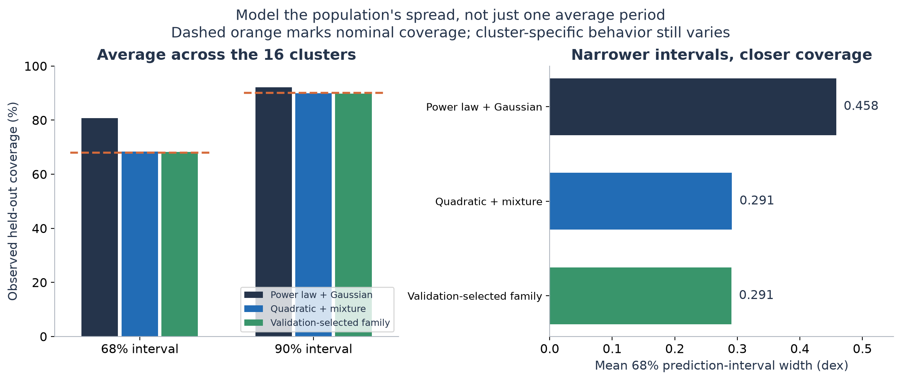

# Real-star results: rotation distributions and cluster ages

The new model improves prediction on real stellar observations. Across the same
721 stars, 16 held-out clusters and 48 splits as the initial study, the quadratic
mixture improves both negative log likelihood (NLL) and continuous ranked
probability score (CRPS) over a Gaussian power-law baseline. It also improves
median-prediction absolute error. Its mean-prediction RMSE does not improve.

This follow-up models a distribution of rotation periods instead of expecting
one curve to represent both the narrow slow sequence and the broader tail. The
mean of the slow component remains an explicit quadratic in log age and color.
A second Gaussian lies at shorter log periods; its weight depends on age and
color. These statistical components do not identify individual stars as binaries
or assign physical evolutionary states.

[Protocol](REAL_STAR_PROTOCOL.md) · [Prediction tool](../scripts/predict_rotation.py) ·
[Complete result bundle](../project/results/real_stars_v2/)

## Fixed comparison on real observations

Every row uses the same discovery, validation and test clusters. Test-cluster
periods never select parameters, penalties or model families. Regularization and
the final family selector use only the three validation clusters in each fold.
All stars and difficult clusters are retained. The Gaussian power-law point
predictions reproduce the initial study's fitted-power-law scores.

Lower NLL, CRPS, RMSE and MAE are better. NLL is a log-density score in nats and
can be negative; the other errors are in dex of rotation period. Coverage is
averaged within seeds, then equally over clusters. MAE evaluates the predicted
median; RMSE evaluates the predicted mean of log period.

| Model | NLL | CRPS | Mean RMSE | Median MAE | 68% coverage | 90% coverage |
| --- | --- | --- | --- | --- | --- | --- |
| Power law + Gaussian | 0.0061 | 0.1205 | 0.2195 | 0.1516 | 80.7% | 92.1% |
| Quadratic + Gaussian | -0.0065 | 0.1166 | 0.2144 | 0.1442 | 81.2% | 91.3% |
| Quadratic + variable scatter | 0.0192 | 0.1156 | 0.2131 | 0.1436 | 83.2% | 89.7% |
| Smooth residual model | 0.0205 | 0.1204 | 0.2212 | 0.1499 | 79.6% | 89.9% |
| Power law + mixture | -0.2964 | 0.1122 | 0.2213 | 0.1398 | 69.6% | 84.0% |
| Quadratic + mixture | -0.4960 | 0.1080 | 0.2251 | 0.1339 | 68.4% | 90.0% |
| Validation-selected family | -0.5017 | 0.1065 | 0.2231 | 0.1316 | 68.2% | 89.8% |

The predeclared primary difference, quadratic mixture minus Gaussian power law,
is **-0.5021 nats**, with descriptive paired 95% interval
**[-0.6694, -0.3346]**. The mixture improves
NLL in 15 of 16 cluster averages. CRPS improves by approximately 10.3%, with paired
difference -0.0124 dex and interval
[-0.0188, -0.0043]. This second proper score
supports the distributional improvement rather than a claim based only on a
sharper density peak.


The mixture's 68% and 90% prediction intervals achieve 68.4% and 90.0% coverage
on average. The baseline's corresponding coverage is 80.7% and 92.1%. The mixture's
mean 68% interval is narrower (0.291 versus 0.458 dex). This is a useful observed
calibration result, not a guarantee for every color, cluster or future population.
These intervals describe population spread, not uncertainty on the mean relation.



## Recovering withheld cluster ages

Each test cluster's periods and colors are evaluated over the fixed 80-5000 Myr
grid; the maximizing likelihood gives a point estimate. Its catalogue age is
used only afterward for scoring. Across three seeds, inferred log ages are
averaged before comparison. Catalogue ages are the original study's averages
of published isochrone estimates, not new gyrochronological labels.

Median absolute fractional error is **18.3%** for the Gaussian power law,
**12.5%** for the quadratic mixture, and **9.9%** for the family selected using
validation data. The corresponding mean absolute log-age errors are 0.1126,
0.0952 and 0.0921 dex. All 16 clusters remain in these calculations.

| cluster | reference_age_myr | Power law | Quadratic + mixture | Validation-selected family |
| --- | --- | --- | --- | --- |
| M50 | 135.0 | 152.0 | 150.0 | 150.0 |
| M34 | 161.0 | 259.0 | 299.0 | 299.0 |
| M35 | 188.0 | 186.0 | 178.0 | 178.0 |
| NGC2516 | 263.0 | 207.0 | 176.0 | 176.0 |
| NGC1750 | 322.0 | 136.0 | 97.0 | 97.0 |
| NGC3532 | 398.0 | 490.0 | 405.0 | 405.0 |
| M37 | 446.0 | 475.0 | 407.0 | 407.0 |
| NGC2548 | 462.0 | 641.0 | 545.0 | 545.0 |
| NGC2281 | 608.0 | 497.0 | 509.0 | 509.0 |
| Praesepe | 718.0 | 728.0 | 775.0 | 775.0 |
| NGC6866 | 735.0 | 744.0 | 775.0 | 775.0 |
| Hyades | 775.0 | 671.0 | 822.0 | 822.0 |
| NGC6811 | 1004.0 | 1188.0 | 1000.0 | 1000.0 |
| NGC6819 | 2310.0 | 1176.0 | 1945.0 | 2187.0 |
| Ruprecht147 | 2454.0 | 3969.0 | 2891.0 | 2891.0 |
| M67 | 3870.0 | 4447.0 | 3329.0 | 3329.0 |


The median improvement is encouraging, but the paired interval on the selected
model's change in mean absolute log-age error is [-0.0685,
+0.0218] dex and spans zero. M34, NGC1750 and NGC2516 remain
difficult. One of the 48 selected age fits reaches the grid boundary. The saved
tables include every boundary flag. The product likelihood does not account for
shared systematic age errors or all model-parameter uncertainty, so no calibrated
cluster-age confidence intervals or 10%-accurate individual-star ages are claimed.

## External observations: 25 new M67 stars

The external sample comes from Gruner, Barnes & Weingrill (2023), via a pinned
gyro-interp data file. It supplies Gaia DR3 identifiers, dereddened BP-RP, periods
and period uncertainties. The selected 25 stars share **no IDs with the entire
original 8,412-entry catalogue**. All M67 stars are excluded from both discovery
and validation in the three frozen models used here. There is no refitting or
model selection on external errors.

At the paper's nominal 4.0 Gyr age:

| Model | nll | crps | rmse_dex | mae_dex | coverage68 | coverage90 |
| --- | --- | --- | --- | --- | --- | --- |
| Quadratic + variable scatter | -0.667 | 0.0625 | 0.1275 | 0.0739 | 0.9067 | 0.96 |
| Power law + Gaussian | -0.3203 | 0.0913 | 0.1537 | 0.1328 | 0.96 | 0.96 |
| Quadratic + Gaussian | -0.4235 | 0.0735 | 0.1249 | 0.0654 | 0.96 | 0.96 |
| Smooth residual model | -0.3245 | 0.0925 | 0.1594 | 0.1292 | 0.9333 | 0.96 |
| Power law + mixture | -0.2489 | 0.0997 | 0.184 | 0.1395 | 0.2133 | 0.6933 |
| Quadratic + mixture | -0.8612 | 0.0575 | 0.1174 | 0.0793 | 0.92 | 0.9733 |
| Validation-selected family | -0.8612 | 0.0575 | 0.1174 | 0.0793 | 0.92 | 0.9733 |

Mean-prediction RMSE falls from **0.1537 to 0.1174 dex**, approximately **23.6%**,
for the quadratic mixture versus the Gaussian power law. CRPS falls from 0.0913
to 0.0575 dex. The ordinary quadratic Gaussian is competitive (0.1249 dex RMSE)
and has lower median MAE than the mixture; the mixture does not win every metric.


The quadratic mixture infers 3.38 Gyr for this external group, versus 4.75 Gyr for
the power law and 4.02 Gyr for the ordinary quadratic Gaussian. The adopted 4.0 Gyr
age is approximate; the source also discusses a 3.6 Gyr isochrone fit. A saved
3.87 Gyr sensitivity evaluates the same stars and frozen models. We do not choose
an age scale based on which makes a method look best.

This is a separate-star check within one old cluster, not a new cluster-age
calibration or field-star validation. The authors' single-main-sequence selection
differs from the broader primary sample. Its 68% mixture intervals cover 92.0%
of these external observations, showing overcoverage for this selected population.
The published half-period-sequence corrections are retained unchanged. Every
selected star is plotted, including the fast-rotation outlier. Source and
reddening details are in the [external data record](../project/data/external/README.md).

## Use the fitted model

`application_model.json` fits the quadratic mixture to all 721 primary stars
after the evaluation. It uses the most frequent inner-validation penalty (ties
favor stronger regularization). This application fit is separate from all
held-out/external metrics. It predicts the rotation distribution at a supplied
age and dereddened Gaia color:

```bash
.venv/bin/python scripts/predict_rotation.py --age-myr 1000 --bp-rp 1.0
```

For that example, the predicted median is about 11.1 days, with a 68% population
interval of 7.5-12.9 days. The script enforces the observed 135-3870 Myr and
0.65 < BP-RP < 1.5 application domain. This is not an individual-star age calculator.

For a coeval group with measured periods and colors, the cluster-age tool needs
`Prot` (days), `BPRP_0` and optionally `GaiaDR3_ID` columns. The external example
uses fits that exclude all M67 training and validation stars:

```bash
.venv/bin/python scripts/infer_cluster_age.py project/results/real_stars_v2/external_stars.csv --holdout-cluster M67
```

It returns 3.38 Gyr. The input catalogue age is never used to estimate this age.
Omitting the holdout option uses the full-data application fit for a new group.
Known training-ID overlap is rejected when identifiers are supplied. The output
reports age-grid boundary hits; variation between fits is not a confidence interval.

## Reproduce and inspect

```bash
OPENBLAS_NUM_THREADS=1 .venv/bin/python scripts/run_real_star_study.py
.venv/bin/python scripts/evaluate_external_m67.py
.venv/bin/python scripts/fit_rotation_model.py
.venv/bin/python scripts/report_real_stars.py
OPENBLAS_NUM_THREADS=1 .venv/bin/python scripts/verify_real_star_reproducibility.py
.venv/bin/python -m pytest -q
```

The runner resumes completed folds, checks source and split hashes, and saves all
candidate parameters and validation choices. Its manifest and the earlier study
remain intact. Tests verify likelihood gradients, normalized densities, CRPS,
quantiles, split separation, complete predictions, unchanged baseline scores,
external non-overlap, frozen model hashes and age-grid maxima.
An independent replay refitted all 528 candidate configurations across 48 folds;
all 17,421 compared numerical values matched exactly in the recorded environment.
The saved `reproducibility.json` records this check. Cluster-age command tests
also verify that reference-age columns cannot supply the inferred age and known
training-ID overlap is rejected.

These experiments were designed after inspecting the earlier results, and the
same observational catalogue remains an exploratory development benchmark.
Descriptive bootstrap intervals treat clusters as the resampling units but do
not include all dependence from overlapping training sets or systematic age
uncertainty. No result establishes a new physical braking law. The concrete
progress is a better tested probability model on real observations, an external
sample check, and a usable rotation-prediction tool.

## Scientific context and contributions

[ChronoFlow](https://arxiv.org/abs/2412.12244) and
[gyro-interp](https://arxiv.org/abs/2303.08830) motivate modeling rotational
dispersion; this study implements a simpler parametric comparison, not their
full published methods. [Gruner et al. (2023)](https://arxiv.org/abs/2305.16997)
provide the external observations. Published data and existing statistical
methods are credited to their sources. This revision used AI assistance for
research, implementation, experiment execution, diagnosis, figures and writing.
